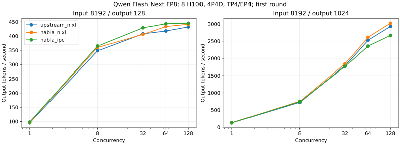

# H100 4P4D 基线

**采集状态：进行中。** 正式吞吐、延迟表和复现数据在实验结束后填入。
此文档在结果完成前不作为性能结论发布。

## 固定条件

- 硬件：8× NVIDIA H100 80GB HBM3，同机 NVLink。
- Prefill：GPU 0～3，TP=4、EP=4、DP=1、PP=1。
- Decode：GPU 4～7，TP=4、EP=4、DP=1、PP=1。
- 当前上游基线：`8e45c458f619dbabff879c0f53c58fd9f296e983`。
- 首轮运行时：`0c8180886e9340ada6f3fe725e5361cfebea0b59`。
- 新运行时：`b1e3f20751cd7cd602c8d7df896bd33a63e781f0`。
  新矩阵两侧显式设置 `--renderer-num-workers 4`；历史矩阵与 CPU 诊断使用 1。
- 公共 benchmark client 和代理基于同一上游 `8e45c458f6`。
  三条路径的代理到后端连接均设置 `max_keepalive_connections=0`，不重试请求。
- 历史记录使用上游 `fab14ef3bde87cae47f3d07ac50fc00f4bb477d6`
  和 nabla-vllm `e318553ff1fdce1558e7d82bb3852126386e7eac`，单独归档。
- 比较路径：上游 NIXL、nabla-vllm NIXL、nabla-vllm CUDA IPC。
- 主矩阵：固定 dataset seed，greedy，ignore EOS；关闭 speculative decoding 和 prefix caching。
- Qwen：两侧 `max_num_batched_tokens=4096`，GPU 利用率预算 0.90。
- DeepSeek：两侧 `max_num_batched_tokens=1024`，固定 KV 预算 640 MiB。
  `gpu_memory_utilization` 参数设为 0.97；显式 KV 预算会跳过自动 KV profiling，
  并取代该参数的 KV 预算计算。
- 两个模型均开启 Engram CPU offload；关闭 async scheduling 和 extensible KV cache。

## 软件与构建来源

| 组件 | 本次版本 |
| --- | --- |
| PyTorch | 2.14.0，CUDA 13.0 |
| Triton | 3.8.0 |
| Transformers | 5.23.0 |
| FlashInfer | 0.7.4 |
| NIXL | 1.5.0 |
| Humming kernels | 0.1.20 |
| InstantTensor | 0.2.3 |

宿主驱动为 `535.261.03`；本次两套引擎均通过
`LD_LIBRARY_PATH=/usr/local/cuda-compat:...` 使用 CUDA forward-compat 库。
该设置属于实验环境，复现时需一并核对。

两套引擎分别构建核心和 MoE 扩展。源码未变化的扩展复用已核对的产物，
完整实验 manifest 记录归属、源码版本和每个 `.so` 的 SHA256。
H100 使用 SM90 编译路径。该实验没有验证 H20 或 B200。

## 输入输出矩阵

| 输入 tokens | 输出 tokens | 首轮并发 |
| --- | --- | --- |
| 128 | 128、1024 | 1、8、32、64、128 |
| 2048 | 128、1024 | 1、8、32、64、128 |
| 8192 | 128、1024 | 1、8、32、64、128 |
| 32768 | 128 | 1、8、32、64、128 |
| 65536 | 128 | 1、8 |
| 32768 | 1024 | 1、8 |

每点请求数为 `max(8, 2 × concurrency)`。
第二、三轮复测并发 1、8 和首轮上游吞吐达到峰值 95% 的最小并发，
三组配置共用选点规则。共享前缀另测 8192 token 前缀加 256 token 后缀，输出 128 tokens。

共享前缀测试之后，另做串行 Prefill 续写检查：固定 8192 token 前缀，
两次请求使用不同的 256 token 后缀，各输出 1 token。
通过 Prefill 本地查询与命中计数的增量记录实际复用边界，
与 Decode 的远端 KV 命中分开。这个检查的耗时不计入吞吐矩阵。

这是一组固定配置下的合成服务基线。吞吐和延迟一起比较，
每轮保留实际输入输出长度、成功请求数和原始请求统计。

## 新运行时的 Qwen 首轮

上游 `8e45c458f6` 与 nabla-vllm `b1e3f20751` 的历史 Qwen FP8 权重
分别完成三条路径，每条 39 个有效点，共 117 个点。
两侧均使用 4 个 renderer worker，不启用 CPU 计时探针。
每个点的请求完成数和实际输入输出长度均符合计划。
NIXL 和 CUDA IPC 各有 24 条串行同路径 token 对照与上游一致，logprobs 均为有限值。
四个 Decode rank 均实际提交了 CUDA IPC copy，首次各有 3 个 span、29,478,912 bytes。

下表对每点计算 output throughput 与同点上游的比值，再取中位数。
各点权重相同，每点只有一轮，不表示生产流量的总收益。

| 路径 | 对照点数 | 吞吐比中位数 | 低于上游的点数 | 最低吞吐比 |
| --- | --- | --- | --- | --- |
| nabla NIXL | 39 | 1.0237 | 2 | 0.9916 |
| nabla CUDA IPC | 39 | 1.0335 | 6 | 0.8872 |

NIXL 的最大比值出现在 128／1024、并发 64：
上游为 3521.95 output tok/s，nabla 为 3749.30；
TPOT p50 分别为 17.50 和 16.46 ms。

IPC 的最低点为 65536／128、并发 8：
上游为 52.68 output tok/s，IPC 为 46.74，回退 11.3%。
8192／1024 的高并发点也有回退，需由后续重复实验确认。
图中展示 8192 输入的两种输出长度；完整 117 个点的吞吐、延迟与请求数
见 [Qwen 首轮 CSV](qwen-first-round.csv)。



## 新运行时的 DeepSeek 首轮

上游 `8e45c458f6` 的 NIXL 路径和 nabla-vllm `b1e3f20751` 的
NIXL、CUDA IPC 路径各完成 39 个有效点，两侧均使用 4 个 renderer worker。
每点请求完成数、输入输出长度和错误字段均已核验。
后续重复实验仍在进行。

| 路径 | 对照点数 | 吞吐比中位数 | 低于上游的点数 | 最低吞吐比 |
| --- | --- | --- | --- | --- |
| nabla NIXL | 39 | 1.0027 | 18 | 0.9604 |
| nabla CUDA IPC | 39 | 1.0012 | 19 | 0.9471 |

旧版本回退最大的 128／1024、并发 128 点，本轮上游为
2543.42 output tok/s，nabla NIXL 为 2530.18，吞吐比为 0.9948。
TPOT p50 分别为 44.59 和 43.54 ms，p95 分别为 47.93 和 49.06 ms。
同点 CUDA IPC 为 2546.34 output tok/s，TPOT p50 为 43.81 ms，p95 为 47.65 ms。
两条 nabla 路径的最低吞吐比都出现在 2048／1024、并发 128，分别为 0.9604 和 0.9471。
这些结果表明本轮未复现旧版本的大幅回退，但仍有最高 5.3% 的单点差距，
需要后续重复实验确认。该比较同时包含缓存修复和两侧 renderer 配置变化，
不能将全部变化单独归因于缓存分配优化。

完整 117 个点的吞吐、延迟和请求数见
[DeepSeek 首轮 CSV](deepseek-first-round.csv)。
这组数据只有一轮，也不表示 DeepSeek 已通过数值一致性或模型质量评估。
NIXL 和 CUDA IPC 在正式计时前各完成 24 组串行对照，logprobs 均为有限值，
但各有 18 组 token 输出与上游不同。四个 decode rank 均实际提交了 CUDA IPC copy，
首次各有 4 个 span、1,735,872 bytes。原有数值验证限制仍然适用。


## 历史首轮与回退诊断

历史 Qwen 和 DeepSeek 各完成三条路径、每条 39 个点，共 234 个有效结果。
下面统计每个测试点的 output throughput 与同点上游结果之比，再取中位数。
各点权重相同，该统计不表示生产流量的整体收益；目前每点只有一轮。

| 模型与路径 | 对照点数 | 吞吐比中位数 | 低于上游的点数 |
| --- | --- | --- | --- |
| 历史 Qwen，NIXL | 39 | 1.0288 | 3 |
| 历史 Qwen，CUDA IPC | 39 | 1.0384 | 1 |
| DeepSeek，NIXL | 39 | 0.9365 | 31 |
| DeepSeek，CUDA IPC | 39 | 0.9597 | 29 |

DeepSeek 最大回退出现在输入 128、输出 1024、并发 128：
上游为 2586.80 output tok/s，nabla NIXL 为 1782.52，CUDA IPC 为 1761.88。
同点 NIXL 的 TPOT p50 从 43.73 ms 增至 65.45 ms，p95 从 47.45 ms 增至 81.38 ms。
两种传输路径都出现回退，需要继续定位服务执行开销。

另外完成了 12 组同形状、真实权重的 DeepSeek GPU forward 对照。
沿用 Decode 的 GPU 4～7、TP4／EP4 和 CPU affinity，排除 sampler 与 CPU step 开销。
两侧固定 KV 预算为 672 MiB，用于容纳 128 个 KV 长度 1024 的精确请求；
正式服务矩阵仍使用 640 MiB。每个点为 20 iterations × 5 samples。

| Forward 形状 | 上游中位延迟 ms | nabla 中位延迟 ms |
| --- | --- | --- |
| Decode 128 × 1，KV 长度 128 | 24.8767 | 24.8892 |
| Decode 128 × 1，KV 长度 1024 | 27.5449 | 27.5447 |

12 个点的 nabla／上游延迟比为 0.9961～1.0020，暂未显示出足以解释服务回退的 GPU 差异。
这组 zero-KV forward 计时之后又补了真实 serving trace。两侧 graph/eager 数值对照均有明显差异，
这些 forward 结果用于性能定位，不表示数值验证通过。

诊断发现旧 forward batch builder 假定所有组共享物理 stride，无法正确分配独立池。
本轮诊断通过外部适配使用真实 arena 分配，逐组读取 capacity，并恢复实际写入的 ID。
仓库中的对应修复为 `e6da11a574`，已通过 12 项 CPU 行为测试，以及三组四卡 GPU 入口验证。
GPU 入口验证使用仓库代码分配和恢复缓存，保留 graph/eager 的数值差异。
正式服务结果不依赖该诊断适配。

随后用“输入 128、输出 1024、并发 128”记录 CPU 调度耗时，两侧均完成 256 个请求。
上游与首轮 nabla 的调度 p50 分别为 4.65 ms 和 17.91 ms；
nabla 反复扫描空闲字节区间、计算可用 slot 的平均耗时为 9.41 ms。
这些数据来自带计时探针的独立诊断，保留在正式吞吐矩阵之外。

修复候选 `2e412a7fd0cb7badd42ab25a93150808f1fcadef` 按 stride 增量维护精确的空闲 slot 数，
并跳过没有新分配和前缀命中的空 admission 规划。原有字节对齐、借用与引用规则保持一致。
Linux 上扩展后的 cache／prefix／checkpoint 套件通过 **528 passed in 38.76s**。
同机 CPU 微基准中的 128 次 slot 查询从 17.38 ms 降至 0.022 ms，
128 个请求分配得到的物理 ID 指纹一致。
该候选的诊断吞吐为 2219.13 output tok/s，调度 p50 为 7.63 ms。
随后 `7c66d8f1a8` 去掉了提交分配时的重复容量查询；诊断吞吐为 2210.54，
没有显示出超出波动的额外提升。这些单点数据不替代正式矩阵。

两侧又完成了完整的 worker／engine 计时诊断，各完成 256 个请求。
上游与 `7c66d8f1a8` 的吞吐分别为 2512.99 和 2229.19 output tok/s，
调度 p50 分别为 4.64 和 7.21 ms；输入准备和采样的 CPU 时间接近。

真实 serving 的四个 rank 各抓了 8 个 decode step，并记录 32 个 engine step 的 CPU 调用。
上游 GPU kernel 总耗时为每 step 29.63～29.73 ms，nabla 为 29.46～29.76 ms；
带 profiler 的捕获跨度分别为 47.69～47.72 和 51.25～51.64 ms。
跨度包含 step 之间的 CPU 等待和 profiler 开销，不作为未插桩的 GPU 延迟。
这组证据指向调度路径的额外工作，未发现主要 MoE GEMM 或 MLA kernel 的大幅变慢。

新运行时 `2f988fa77a` 精简了无新 page、无 prefix hit 的准入路径，
同时省去空需求的字节计价。需要分配或携带 prefix hit 时仍使用完整的字节检查。
扩展后的真实 manager 测试检查页内续写保留 ID 和预算，跨边界仍独立分配 KV 与 state。
不可变源码上的完整缓存套件通过 **528 passed in 26.59s**。
H100 原生 byte copy／zeroing 通过 **4 passed, 83 deselected in 22.56s**。
离线 `LLM`、`LLM.from_engine_args` 和显式配置 8 worker 的实际入口分别保持 1、1、8，
均完成一次真实小 Qwen 模型的生成。该检查使用 dummy 权重，只验证入口行为。
`2f988fa77a` 的单点诊断完成 256 个请求，输出吞吐为 2253.07 tok/s，
上游为 2523.00 tok/s；调度 p50 分别为 6.27 和 4.63 ms。
该诊断中，nabla 在约 90%～92% 的 live-byte 使用率下发生抢占，
上游接近 97%～100%。nabla 调度了 329,877 tokens，上游为 308,117，
包含不同数量的重算工作。

随后 `b1e3f20751` 使用各 stride 的软地址 cursor 聚集新分配。
初始请求需求只决定起始地址，不为任何缓存类型预留配额；遇到占用仍从公共空闲区分配。
相同 128 请求的 CPU 布局检查中，空闲区间从 508 个降至 4 个，
live bytes 均为 641,335,296。完整缓存套件通过 **529 passed in 24.50s**。
forward 的非连续 ID 检查改用混合 decode／prefill 请求，保持 320 bytes 的预算与
原有清零、恢复、邻接区间断言，完整套件通过 **19 passed in 9.75s**。
这次布局改变会改变物理 ID，不沿用之前“分配 ID 一致”的结论。
成对 GPU 服务诊断两侧各完成 256 个请求。上游为 2527.32 output tok/s，
nabla 为 2445.96，比例为 0.9678；调度 p50 分别为 4.67 和 6.28 ms。
两侧调度 token 总数分别为 308,155 和 309,534，抢占次数为 151 和 145。
这些数据使用 CPU 计时探针和 1 个 renderer worker，单独归档。
最新源码的正式矩阵已开始，两侧均使用 4 个 renderer worker，且不启用计时探针。

## 复现配置

两套源码分别安装和编译，客户端固定使用上游 `8e45c458f6`。
以下变量指向本地模型目录和已编译的源码；每次只启动一套 P/D 服务。
Prefill 和 Decode 的 CPU affinity 分别为 `0-50,104-154`、
`52-102,156-206`，复现时按机器实际 NUMA 拓扑核对。

```bash
export PYTHONPATH=<compiled-source>
export LD_LIBRARY_PATH=/usr/local/cuda-compat:${LD_LIBRARY_PATH:-}
export VLLM_USE_RUST_FRONTEND=0 VLLM_SSM_CONV_STATE_LAYOUT=DS
export VLLM_SERVER_DEV_MODE=1 VLLM_ENGINE_READY_TIMEOUT_S=3600
export HF_HUB_OFFLINE=1 TRANSFORMERS_OFFLINE=1 OMP_NUM_THREADS=1
export UCX_NET_DEVICES=all
model_path=<local-weights>
model_label=qwen_fp8_historical
ipc=false
model_args=(--gpu-memory-utilization 0.90 --max-num-batched-tokens 4096
  --moe-backend triton --kv-cache-dtype fp8
  --attention-config.indexer_kv_dtype fp8)
```

DeepSeek 使用同一组公共参数，替换模型和下面的参数数组：

```bash
model_label=deepseek_v41_flash
model_args=(--gpu-memory-utilization 0.97 --max-num-batched-tokens 1024
  --kv-cache-memory 671088640 --tokenizer-mode deepseek_v41
  --kernel-config '{"linear_backend_per_quant":{"mxfp8":"humming"}}')
```

在两个终端中分别设置角色，再运行同一个启动命令。主矩阵的 `ipc=false`；
nabla-vllm CUDA IPC 对照组设为 `true`。上游组保持 `false`。

```bash
# Prefill terminal
export CUDA_VISIBLE_DEVICES=0,1,2,3 VLLM_NIXL_SIDE_CHANNEL_PORT=5600
port=8100
kv_role=kv_producer
cpus=0-50,104-154

# Decode terminal
export CUDA_VISIBLE_DEVICES=4,5,6,7 VLLM_NIXL_SIDE_CHANNEL_PORT=5601
port=8200
kv_role=kv_consumer
cpus=52-102,156-206

# Run once in each role terminal after setting that role's variables.
kv_config="{\"kv_connector\":\"NixlConnector\",\"kv_role\":\"$kv_role\",\"kv_load_failure_policy\":\"fail\",\"kv_connector_extra_config\":{\"enable_local_fastpath\":$ipc}}"
taskset -c "$cpus" .venv/bin/python -m vllm.entrypoints.cli.main serve "$model_path" \
  --served-model-name "$model_label" --host 127.0.0.1 --port "$port" \
  --tensor-parallel-size 4 --enable-expert-parallel --max-model-len 131072 \
  --max-num-seqs 128 --engram-config '{"cpu_offload":true}' --language-model-only \
  --renderer-num-workers 4 \
  --disable-prefix-caching --disable-extensible-kv-cache --no-async-scheduling \
  --kv-transfer-config "$kv_config" "${model_args[@]}"
```

公共代理以固定上游的 `tests/v1/kv_connector/nixl_integration/toy_proxy_server.py`
为基础，只把两个 `httpx.AsyncClient` 的 `max_keepalive_connections` 改为 `0`，
保留 `max_connections=None`。启动参数为：

```bash
.venv/bin/python benchmark-proxy-httpfresh.py --host 127.0.0.1 --port 8192 \
  --prefiller-hosts 127.0.0.1 --prefiller-ports 8100 \
  --decoder-hosts 127.0.0.1 --decoder-ports 8200
```

为矩阵脚本准备本地 manifest，`models` 中每个模型包含 `weight_path`；
DeepSeek 再包含 `tokenizer_mode="deepseek_v41"`。主矩阵使用仓库中的
`benchmarks/specialized/serve_matrix.py`：

```bash
PYTHONPATH=<pinned-upstream-source> VLLM_TARGET_DEVICE=empty \
  .venv/bin/python benchmarks/specialized/serve_matrix.py \
  --manifest local-experiment.json --output-root results \
  --model qwen_fp8_historical --arm upstream_nixl --round 1 \
  --base-url http://127.0.0.1:8192
```

每次切换源码或 IPC 设置时重启两侧服务和代理，再改变 `--arm`。
第二、三轮使用 `--round 2`、`--round 3`；三条路径读取同一上游首轮结果选点。
共享前缀实验重新启动服务，改为 `--enable-prefix-caching`；每个点先重置两侧缓存。
unique 请求设置 `--random-input-len 8448 --random-prefix-len 0 --num-warmups 0`，
shared 设置 `--random-input-len 256 --random-prefix-len 8192 --num-warmups 1`。
两者均使用 `--ready-check-timeout-sec 0`、输出 128、并发 1／8／32，
其余客户端选项与主矩阵一致。

## 测试链路修复记录

最初的上游首轮在 8192 输入、1024 输出、128 并发时完成 254/256 个请求。
代理在获取 Prefill 响应头时报告 `httpx.ReadError`，GPU 服务进程保持运行。
该点的成功请求吞吐为 2930.33 output tok/s，因请求不完整，不计入有效基线。

修复后的实验统一关闭代理后端的空闲连接复用，三条路径从头重新采集。
原始实验保留，结果与新实验分开。公共代理仅改动两处连接池设置，
文件 SHA256 为 `95693e981c1ffa4950680a4560ca99f15cbadc391a1c5ab45b706bfcd3507437`。
每次切换模型或配置时重新启动代理，避免复用上一组服务的连接。

DeepSeek 的 nabla-vllm NIXL 首轮完整完成后，控制脚本在服务退出等待中超时。
残留 Decode worker 的 Python 栈停在 `torch.distributed.destroy_process_group`。
恢复脚本核对了此前全部 5 组结果的计划覆盖、请求数、实际长度和错误字段，
从下一组继续，保留已完成的数据。清理脚本先发 SIGTERM，等待 120 秒；
超时后仅处理 UID、工作目录、进程组、命令和启动时间仍匹配初始记录的残留进程。
强制清理单独留档。这次修复改变了实验控制和清理流程，模型、服务参数与客户端负载未变。

## 权重与运行检查

历史 Qwen FP8 和补充 FP8 权重各有 144 个文件、185,563,783,577 bytes。
两份完整文件指纹均为
`9ffea2323a0e44acf7a013957adda7a2cff7dd684ff939e2b157602105b220b4`，
因此这两组是同一权重的复测。DeepSeek 权重有 56 个文件、
510,312,375,672 bytes，完整文件指纹为
`bb7ac4092747ef29ff339f5c21a9c36de2a188619b646783c3c71d803a52922a`。

固定源码上的缓存、部分前缀、延迟释放和 checkpoint 分割测试通过：
**525 passed in 26.37s**。两份 Qwen 权重分别完成 24 个串行同路径 token 对照，
合计 48 个结果与上游一致。并发请求结果单独保留。

DeepSeek 的默认模式严格 token 对照有 **21/24** 个结果不同。
上游同一提示的两次 P/D 调用也在 8 组长度中有 6 组输出不同。
上游另行启动的 batch-invariant 诊断被 `DEEPSEEK_SPARSE_SWA` 后端拒绝。
这些检查保留原始失败状态。按照本次只测性能的要求，性能采集验证请求完成数、
实际长度和运行指标；DeepSeek 的数字不表示已通过数值一致性或模型质量评估。
