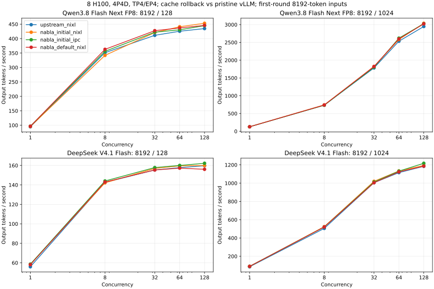
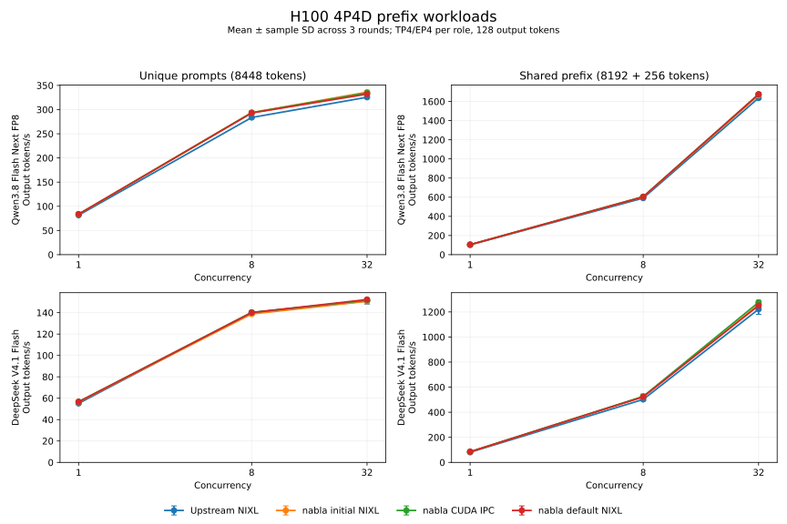

# H100 缓存回退与 Connector 对照

本实验比较缓存回退后的 nabla-vllm、初建 NixlConnector、上游默认
NixlConnector 和未经修改的 vLLM。主矩阵及共享前缀均已完成，结果与验证边界如下。
历史 v0.1.0 数据见 [原始基线记录](h100-4p4d-20261120.md)。

## 两份源码独立比较 Connector

| 对照组 | 固定源码 | 传输路径 |
| --- | --- | --- |
| 原始 vLLM | `8e45c458f619dbabff879c0f53c58fd9f296e983` | 上游默认 NixlConnector |
| nabla 初建 connector | `f4a4ab4ccc19c111ebc426e6739e2e4085a04eef` | 保留 #65639，关闭 CUDA IPC |
| nabla 初建 connector，CUDA IPC | `f4a4ab4ccc19c111ebc426e6739e2e4085a04eef` | 保留 #65639，显式开启 CUDA IPC |
| nabla 默认 connector | `85a2d4572e51511ef4ca73a8d623dc89cd596db3` | 恢复上游默认 NixlConnector |

两份 nabla 源码的缓存、模型、内核和调度代码相同。默认 connector 版本将
NIXL 实现文件逐个恢复为上游 `8e45c458f6`，删除 CUDA IPC 扩展及其专用测试。
初建 connector 指本仓库集成的
[#65639](https://github.com/vllm-project/vllm/pull/65639) 路径及其安全修正。
P 和 D 在每组实验中使用匹配的源码，初建 connector 协议版本为 20，
上游与默认 connector 版本为 17。

KV／GDN 的分组、分配、前缀保留和清零／复制已恢复到原始 vLLM。
回退包括混合模型块对齐和 GDN 页面 padding。
第一版 `8aaf0470ca` 遗漏了 Qwen 对齐路径，已停止其下游测试，保留失败与部分结果。
本报告的下游数据只使用修正后的源码。

## 配对点使用相同的请求条件

一个配对点包含模型、输入 token 数、输出 token 数、并发和轮次。
例如，Qwen3.8-Flash-Next-FP8 的 `8192／128、并发 8、第二轮`，
在四组实验中使用相同的 dataset seed 和采样参数。
先计算同点三轮均值，再比较吞吐、TTFT 和 TPOT；同时保留各轮波动。
各点等权的比值中位数不能解释为生产流量的总收益。

- 同机 8× NVIDIA H100 80GB HBM3，NVLink。
- P 使用 GPU 0～3，D 使用 GPU 4～7，两侧 TP=4、EP=4、DP=1、PP=1。
- 两侧 4 个 renderer worker，关闭 async scheduling、extensible KV cache 和 speculative decoding。
- 主矩阵关闭 prefix caching，固定 greedy、ignore EOS、dataset seed 和无穷请求速率。
- 每点 `max(8, 2 × concurrency)` 个计时请求，1 个 warmup。
- Qwen：`max_num_batched_tokens=4096`，显存利用率预算 0.90，FP8 KV。
- DeepSeek：`max_num_batched_tokens=1024`，显式 KV 预算 640 MiB，Humming MXFP8。
- 两个模型均开启 Engram CPU offload。

| 输入 tokens | 输出 tokens | 首轮并发 |
| --- | --- | --- |
| 128 | 128、1024 | 1、8、32、64、128 |
| 2048 | 128、1024 | 1、8、32、64、128 |
| 8192 | 128、1024 | 1、8、32、64、128 |
| 32768 | 128 | 1、8、32、64、128 |
| 65536 | 128 | 1、8 |
| 32768 | 1024 | 1、8 |

首轮每组每模型扫描 39 点。第二、三轮复测并发 1、8 和首轮上游吞吐
达到峰值 95% 的最小并发，四组共用上游选点。
共享前缀另测 `8192 + 256／128`，unique 与 shared、并发 1／8／32、三轮，
每组每模型 18 点。直接 Prefill 换后缀的边界检查单独记录实际复用 token 数。

## 权重与依赖固定

| 模型 | 权重文件集合 SHA256 |
| --- | --- |
| Qwen3.8-Flash-Next-FP8 | `9ffea2323a0e44acf7a013957adda7a2cff7dd684ff939e2b157602105b220b4` |
| DeepSeek-V4.1-Flash | `bb7ac4092747ef29ff339f5c21a9c36de2a188619b646783c3c71d803a52922a` |

之前两份 Qwen 权重的文件指纹相同，本次只测一份。
PyTorch 2.14.0／CUDA 13.0、Triton 3.8.0、Transformers 5.23.0、
FlashInfer 0.7.4、NIXL 1.5.0、Humming kernels 0.1.20、InstantTensor 0.2.3。
实验使用现有 `uv` 环境和 CUDA forward-compat 库。
C／CUDA／CMake 与依赖输入没有变化，复用原生产物时核对各文件 SHA256。
两份 nabla 源码的 8547／8546 个受版本控制文件已逐个核对。

原始 vLLM 的 Qwen 首轮 39 点和 24 组串行输出检查已在第一版回退实验中完成。
这份原始 vLLM 源码未修改，启动脚本、权重、依赖与请求参数核对一致后，
复用其未修改的原始数据，保留原 manifest 和逐文件哈希。
后续原始 vLLM 的复测轮次重新运行。
第一版不完整缓存回退的下游数据全部排除，历史文件保留。

## 缓存与传输回归

两份源码均运行以下目标缓存测试，使用无推理后端的 metadata 模式：

```bash
VLLM_TARGET_DEVICE=empty HF_HUB_OFFLINE=1 .venv/bin/python -m pytest \
  tests/v1/core/test_prefix_caching.py \
  tests/v1/core/prefix_cache/test_partial_prefix_cache_primitives.py \
  tests/v1/core/prefix_cache/test_partial_prefix_cache_hits.py \
  tests/v1/core/test_deferred_block_free.py -q
```

初建版本：`461 passed in 171.03s (0:02:51)`。
默认版本：`461 passed in 170.09s (0:02:50)`。

```bash
VLLM_TARGET_DEVICE=empty HF_HUB_OFFLINE=1 .venv/bin/python -m pytest \
  tests/v1/core/test_kv_cache_utils.py -q -k qwen_hybrid_alignment
```

初建版本：`2 passed, 114 deselected in 4.90s`。
默认版本：`2 passed, 114 deselected in 4.71s`。
该回归使用真实 Qwen 配置，在开启和关闭 prefix caching 时核对 GDN 与
attention 的物理页面大小。第一版未修正源码的同类检查为 `2 failed`。

```bash
VLLM_TARGET_DEVICE=cuda HF_HUB_OFFLINE=1 .venv/bin/python -m pytest \
  tests/v1/kv_connector/unit/test_nixl_connector.py \
  tests/v1/kv_connector/unit/test_nixl_desc_geometry.py -q -m cpu_test \
  -k 'local_fastpath or local_ipc or first_stream_ordered or real_model_layout_pull_copies_every_page or basic_interface or prompt_less_than_block_size or kv_transfer_handshake'
```

初建版本：`20 passed, 574 deselected in 17.57s`。
默认版本：`14 passed, 569 deselected in 15.74s`。
默认版本没有 CUDA IPC 扩展及其对应测试，两组实际选择的用例数量不同。

扩展六文件缓存测试在 metadata 模式下为
`46 failed, 474 passed in 204.12s (0:03:24)`。
44 项在加载离线环境中缺少的通用模型配置时失败，另外两项触发无 GPU 模式
自动关闭混合缓存管理的规则。后两项在实际 CUDA 平台重新运行，结果为
`2 passed, 114 deselected in 3.73s`。原失败日志保留，扩展套件仍记录为未通过。
同类 NIXL 几何测试在 metadata 模式下为
`6 failed, 14 passed, 574 deselected in 15.46s`；
同一选择在实际 CUDA 平台的通过结果如上，未修改断言或容差。

计时前检查实际请求完成数、长度和有限 logprobs。
Qwen 三组下游的 24 组串行输出对照均与同路径原始 vLLM 一致。
CUDA IPC 组必须在四个 Decode rank 的日志中实际出现复制记录，
控制组必须没有该记录。DeepSeek 本次初建普通 NIXL、IPC、默认 Connector
分别有 19／24、18／24、21／24 组严格 token 对照不同；历史上游自身重复不稳定的
检查仍保留，本次没有把该限制标为已解决。请求完成数、长度及有限 logprobs
通过检查；不将性能测试解释为模型质量评估。

## Qwen 初建 Connector 首轮

缓存回退后的 `f4a4ab4ccc` 与原始 `8e45c458f6` 已完成 39 个同点对照。
下表对每点计算 output throughput 比值，再取中位数，各点等权。
这是单轮统计。下方完整三轮结果使用 24 个共用复测点，与本节的 39 点口径不同。

| 路径 | 对照点数 | 吞吐比中位数 | 低于上游的点数 | 最低吞吐比 |
| --- | --- | --- | --- | --- |
| nabla 初建普通 NIXL | 39 | 1.0228 | 1 | 0.9736 |
| nabla 初建 CUDA IPC | 39 | 1.0265 | 1 | 0.9975 |

普通 NIXL 最低点为 `8192／128、并发 8`，本轮吞吐低约 2.6%。
CUDA IPC 最低点为 `8192／1024、并发 8`，本轮吞吐低约 0.25%。
逐点吞吐、TTFT、TPOT 见 [Qwen 普通 NIXL 首轮 CSV](cache-rollback-qwen-nixl-first-round.csv)。
[CUDA IPC 首轮 CSV](cache-rollback-qwen-ipc-first-round.csv) 同样保留全部 39 点。
四个 Decode rank 已核验实际 IPC copy，首条记录各为 39 spans、40,140,800 bytes。
两份数据使用已修正的缓存源码，历史 v0.1.0 数据单列保留。

## 主矩阵三轮结果

两模型共完成 696 个有效点、50,240 个计时请求。每个模型的每组实验为
首轮 39 点、第二与第三轮各 24 点。所有点的完成数、实际输入输出长度、错误列表、
逐请求 TTFT／ITL／端到端延迟及 throughput 与总 token 数／duration 的关系均已核验。
完整原始 vLLM、初建普通 NIXL、初建 IPC、默认 Connector 共用同点条件。

每点先计算三轮均值，再取同点比值的中位数。TTFT 与 TPOT 使用各轮 p50
的均值，表格中的列各自统计，不能把它们相乘或相减来分解吞吐收益。

| 模型 | 路径 | 吞吐比 | TTFT p50 比 | TPOT p50 比 | 低于上游点数 | 最低吞吐比 | 吞吐 CV 中位数 |
| --- | --- | --- | --- | --- | --- | --- | --- |
| Qwen3.8-Flash-Next-FP8 | 初建普通 NIXL | 1.0179 | 0.9764 | 0.9881 | 1／24 | 0.9975 | 0.75% |
| Qwen3.8-Flash-Next-FP8 | 初建 CUDA IPC | 1.0235 | 0.9480 | 0.9920 | 0／24 | 1.0052 | 0.53% |
| Qwen3.8-Flash-Next-FP8 | 恢复默认 NIXL | 1.0168 | 0.9721 | 0.9889 | 0／24 | 1.0043 | 0.50% |
| DeepSeek-V4.1-Flash | 初建普通 NIXL | 1.0285 | 1.0041 | 0.9504 | 4／24 | 0.9962 | 0.65% |
| DeepSeek-V4.1-Flash | 初建 CUDA IPC | 1.0303 | 0.9903 | 0.9510 | 1／24 | 0.9868 | 0.58% |
| DeepSeek-V4.1-Flash | 恢复默认 NIXL | 1.0279 | 1.0044 | 0.9503 | 5／24 | 0.9563 | 0.77% |

只有三轮数据，这些比值表示实测负载的变化，不表示统计显著性或生产流量总收益。
各点完整 p95 与变异系数见 [48 个复测点 CSV](cache-rollback-all-repeat-points.csv)。

| 模型 | 初建普通 NIXL／默认 | 初建 IPC／默认 | 初建 IPC／初建普通 NIXL |
| --- | --- | --- | --- |
| Qwen3.8-Flash-Next-FP8 | 1.0003 | 1.0023 | 1.0036 |
| DeepSeek-V4.1-Flash | 1.0002 | 1.0043 | 1.0037 |

恢复默认 NIXL 后仍有相近的相对上游提升。普通 NIXL 的两份 Connector
在此口径下接近持平；IPC 的额外收益很小，并非每点都有增益。
不能用两列相对上游的中位数直接相除代替 Connector 同点比值。
完整吞吐及 TTFT／TPOT 直接比值见 [Connector 对照 CSV](cache-rollback-connector-pairs.csv)。

最低点保留如下。表内吞吐均为三轮 output tok/s 均值；CV 为对应下游的吞吐变异系数。

| 模型 | 路径 | 输入／输出、并发 | 上游 tok/s | 下游 tok/s | 比值 | 下游 CV |
| --- | --- | --- | --- | --- | --- | --- |
| Qwen | 初建普通 NIXL | 8192／128、8 | 352.49 | 351.60 | 0.9975 | 2.74% |
| Qwen | 初建 IPC | 8192／1024、1 | 126.49 | 127.15 | 1.0052 | 0.36% |
| Qwen | 默认 NIXL | 128／128、1 | 124.83 | 125.37 | 1.0043 | 0.83% |
| DeepSeek | 初建普通 NIXL | 32768／128、8 | 39.46 | 39.31 | 0.9962 | 1.29% |
| DeepSeek | 初建 IPC | 128／1024、128 | 2563.35 | 2529.56 | 0.9868 | 0.55% |
| DeepSeek | 默认 NIXL | 65536／128、8 | 19.82 | 18.95 | 0.9563 | 7.52% |

DeepSeek 的 IPC 最低点相对同点默认 Connector 的 2620.69 tok/s 低 3.48%。
默认 Connector 的 65K 点有明显波动，三轮及其统计全部保留。
首轮未入选复测的点仍按单轮证据呈现，不能把复测点最低值当作全矩阵最低值。
[696 点 CSV](cache-rollback-all-cases.csv) 与
[18 组同点饱和吞吐和延迟](cache-rollback-matched-saturation.csv) 可用于不同负载的迭代比较。



## 共享前缀三轮结果

缓存开启的实验另完成 144 个有效点、4,224 个计时请求及 8 组边界检查。
与主矩阵合计 840 点、54,464 个计时请求，warmup 和边界请求另算。
unique 为 8448-token 独立输入，不做 warmup；shared 为 8192-token 公共前缀
与 256-token 独立后缀，做 1 次 warmup。两者输出均为 128 tokens，
并发 1／8／32、三轮，每点重置两侧缓存。

以下吞吐和 TTFT 均为同点三轮均值。shared／上游对照的是两边相同的 shared 负载，
不会将 shared／unique 的缓存效应当成本仓库的加速倍数。

| 模型 | 路径 | 并发 | unique tok/s | shared tok/s | unique TTFT p50 ms | shared TTFT p50 ms | shared／上游 |
| --- | --- | --- | --- | --- | --- | --- | --- |
| Qwen | 原始 vLLM | 1 | 81.57 | 102.48 | 564.46 | 257.79 | 1.0000 |
| Qwen | 初建普通 NIXL | 1 | 83.43 | 104.38 | 545.58 | 250.15 | 1.0185 |
| Qwen | 初建 CUDA IPC | 1 | 83.56 | 104.56 | 537.89 | 243.79 | 1.0203 |
| Qwen | 恢复默认 NIXL | 1 | 83.83 | 104.81 | 541.83 | 247.01 | 1.0228 |
| Qwen | 原始 vLLM | 8 | 283.65 | 590.79 | 1878.48 | 434.59 | 1.0000 |
| Qwen | 初建普通 NIXL | 8 | 293.71 | 603.26 | 1799.01 | 423.33 | 1.0211 |
| Qwen | 初建 CUDA IPC | 8 | 293.56 | 605.62 | 1799.90 | 414.12 | 1.0251 |
| Qwen | 恢复默认 NIXL | 8 | 292.99 | 603.35 | 1802.18 | 424.29 | 1.0213 |
| Qwen | 原始 vLLM | 32 | 325.56 | 1636.57 | 10801.96 | 451.64 | 1.0000 |
| Qwen | 初建普通 NIXL | 32 | 336.00 | 1665.07 | 10452.44 | 462.55 | 1.0174 |
| Qwen | 初建 CUDA IPC | 32 | 334.45 | 1675.25 | 10435.53 | 454.93 | 1.0236 |
| Qwen | 恢复默认 NIXL | 32 | 332.09 | 1675.26 | 10560.77 | 448.77 | 1.0236 |
| DeepSeek | 原始 vLLM | 1 | 55.18 | 81.07 | 939.78 | 215.70 | 1.0000 |
| DeepSeek | 初建普通 NIXL | 1 | 56.42 | 84.62 | 942.94 | 210.50 | 1.0437 |
| DeepSeek | 初建 CUDA IPC | 1 | 56.74 | 84.99 | 930.36 | 203.93 | 1.0483 |
| DeepSeek | 恢复默认 NIXL | 1 | 56.62 | 84.74 | 941.89 | 207.73 | 1.0452 |
| DeepSeek | 原始 vLLM | 8 | 140.13 | 502.15 | 5094.27 | 403.35 | 1.0000 |
| DeepSeek | 初建普通 NIXL | 8 | 138.77 | 522.97 | 5281.10 | 370.13 | 1.0415 |
| DeepSeek | 初建 CUDA IPC | 8 | 140.16 | 526.18 | 5198.07 | 363.37 | 1.0479 |
| DeepSeek | 恢复默认 NIXL | 8 | 140.07 | 522.72 | 5185.09 | 362.58 | 1.0410 |
| DeepSeek | 原始 vLLM | 32 | 150.87 | 1221.71 | 24851.51 | 458.97 | 1.0000 |
| DeepSeek | 初建普通 NIXL | 32 | 150.68 | 1256.97 | 24947.17 | 459.08 | 1.0289 |
| DeepSeek | 初建 CUDA IPC | 32 | 151.57 | 1276.23 | 24776.10 | 450.12 | 1.0446 |
| DeepSeek | 恢复默认 NIXL | 32 | 152.25 | 1250.85 | 24687.86 | 486.57 | 1.0239 |

Qwen 的 shared 同点比值约为 1.0174～1.0251，DeepSeek 约为 1.0239～1.0483。
DeepSeek unique 并发 8 的初建普通 NIXL 为 138.77 tok/s，上游 140.13，低 0.97%；
并发 32 为 150.68，上游 150.87，低 0.13%。这些负向样本和各轮波动均保留。
DeepSeek shared 并发 32 的默认 Connector TTFT p50 为 486.57 ms，上游 458.97，
高 6.01%；Qwen 同点初建普通 NIXL 为 462.55 ms，上游 451.64，高 2.42%。
吞吐增益不能代替逐点延迟检查。只有三轮数据，不作统计显著性或 SLA 声明。

直接 Prefill 的串行边界检查固定同一前缀、改变后缀，独立于上述随机吞吐请求。
每组查询 8448 tokens：四组 Qwen 均实际命中 8000，四组 DeepSeek 均命中 8192。
这个计数与 Decode 的远端 KV 命中分开，当前没有恢复历史自定义 checkpoint 策略。

[144 点逐轮 CSV](cache-rollback-prefix-all-cases.csv) 与
[三轮均值、TTFT、TPOT 和波动 CSV](cache-rollback-prefix-summary.csv) 保留全部数据。
下图误差条为三轮吞吐的样本标准差。



## 来源核验与实验退出

实验结束后重新核验初建、默认、原始三份源码的 8547、8546、9692 个受版本控制文件，
以及各 980 个生成／原生依赖文件。848 个结果／边界文件的最终 SHA256 与本地副本一致。
本机重新计算所有 840 点，核对逐请求长度、完成数、错误、有限延迟及吞吐公式，
得到 54,464 个计时请求。完整主矩阵 CSV 与前一次主矩阵汇总逐字节一致。

32 个模型／路径／轮次传输记录中，8 个 IPC 组均在四个 Decode rank 记录实际 copy，
控制组没有本仓库的 IPC copy 记录。Qwen 上游首轮复用此前 39 点，未新启动服务，
该数据的来源和原始 SHA256 已单独核验。

实际启动了 31 组服务。其中 11 次 DeepSeek 退出需要强制清理，
包括 7 次主矩阵和全部 4 次前缀组，涉及原始 vLLM 与三种下游路径。
这些清理都发生在测量和对应边界检查结束之后，未中断计时请求。
本轮不能作为优雅退出通过的证明，原因仍待定位；原始日志与退出记录保留。

只读监视器在控制器退出时出现结束检测误报；最终状态文件和控制器日志均为 complete。
远端后处理已通过源码核验，随后因缺少 matplotlib 停止。本机既有 uv 环境完成
全部分析与绘图，未修改测量环境、数据、断言或容差。原后处理错误日志保留。

## 公开数据与复算

[逐请求数据、8 组边界记录与复算脚本](https://github.com/zhangxin81/nabla-vllm/releases/download/v0.1.0/nabla-vllm-cache-rollback-h100-20261123-data.tar.gz)
包含全部 840 点及原始／公开文件的 SHA256 对应关系，已移除生成文本与内部路径。
公开包实际解压后，848 个数据／边界文件的校验值全部匹配；6 份 CSV 与
4 份统计 JSON 已从公开数据重新计算并与上述结果一致。打包时移除了 macOS
附加元数据和文件属主信息。

[SHA256 校验文件](https://github.com/zhangxin81/nabla-vllm/releases/download/v0.1.0/SHA256SUMS-cache-rollback-20261123.txt)
记录数据包哈希 `f04316cdd61d7c7d1b9cccbefd321a59b8871f08dac3804ddf0d4ca6bb2180ca`。这是追加的缓存回退对照数据，
历史 v0.1.0 标签及原有资产的 ID、大小、哈希未变。

在 uv 环境中安装 matplotlib，解压后按包内 README 使用
`.venv/bin/python analysis/analyze-main.py results recomputed`，再运行
`analyze-repeat.py`、`analyze-connector-pairs.py`、`analyze-prefix.py`、
`plot-prefix.py` 和 `check-raw.py results --expected 840`。重新跑 GPU 时使用
记录中的三份源码、同一上游 benchmark client、两份权重指纹及部署参数。
