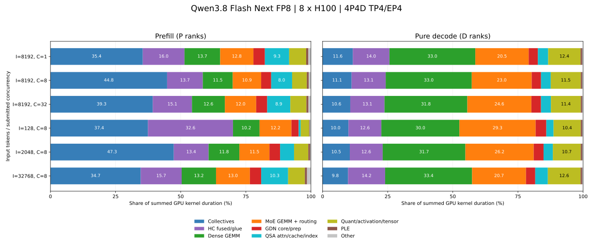

# Qwen3.8 的 H100 算子现状

这份记录面向 nabla-vllm 的 v0.1 迭代：固定最新源码，在同机 8 张 H100 上运行
Qwen3.8-Flash-Next-FP8，将 Prefill、首次 D 接续计算和纯 Decode 的 GPU
活动分开统计。它用于回答各阶段实际执行了什么、时间花在哪里，以及下一步应优先
看哪些路径。历史吞吐对照见[缓存回退与 Connector 实验](h100-cache-rollback-20261122.md)。

主负载 8K／8 中，Prefill 的通信 kernel 占 44.78%，HC 可辨认的融合／辅助
kernel 占 13.70%；纯 Decode 的通用 GEMM 占 33.03%，MoE 专家 GEMM 占
12.80%，routing／combine 占 10.22%，GDN 核心与准备占 3.58%。
Prefill 与 Decode 的热点分布不同，下一步优化应按阶段和真实 batch 选择。



下面只汇总主要类别，未展示的 quantization、activation、PLE、输入准备和
tensor glue 仍保留在后文的完整表格中。“MoE”列为专家 GEMM 加 routing／combine，
“QSA”列只包含 sparse attention／merge。

| 输入／并发 | 阶段 | 通信 | HC 融合／辅助 | 通用 GEMM | MoE | GDN 核心／准备 | QSA attention |
| --- | --- | --- | --- | --- | --- | --- | --- |
| 8192／1 | P | 35.44% | 16.02% | 13.70% | 12.76% | 4.39% | 8.51% |
| 8192／1 | D | 11.62% | 14.05% | 32.98% | 20.48% | 3.52% | 1.56% |
| 8192／8 | P | 44.78% | 13.70% | 11.48% | 10.92% | 3.85% | 7.29% |
| 8192／8 | D | 11.14% | 13.10% | 33.03% | 23.01% | 3.58% | 1.50% |
| 8192／32 | P | 39.27% | 15.06% | 12.64% | 12.01% | 4.24% | 8.03% |
| 8192／32 | D | 10.63% | 13.15% | 31.79% | 24.59% | 3.69% | 1.52% |
| 128／8 | P | 37.43% | 32.65% | 10.21% | 12.22% | 2.78% | 0.46% |
| 128／8 | D | 9.95% | 12.61% | 29.97% | 29.25% | 4.11% | 1.27% |
| 2048／8 | P | 47.34% | 13.38% | 11.83% | 11.54% | 4.08% | 4.79% |
| 2048／8 | D | 10.45% | 12.63% | 31.75% | 26.23% | 3.78% | 1.56% |
| 32768／8 | P | 34.65% | 15.73% | 13.20% | 12.99% | 4.33% | 9.10% |
| 32768／8 | D | 9.79% | 14.23% | 33.38% | 20.69% | 3.56% | 1.58% |

## 测量固定了哪些条件

| 项目 | 本次条件 |
| --- | --- |
| 源码 | `775e785ac3f34a9becb0d1dbd828d1c34b745277` |
| 定位 | 2026-11-24 采集的 v0.1 现状快照；历史 `v0.1.0` 发布单独保留 |
| GPU | 同机 8× NVIDIA H100 80GB HBM3，SM90 |
| 并行 | GPU 0～3 为 P；GPU 4～7 为 D；各 TP=4、EP=4、DP=1、PP=1 |
| Connector | 本仓库 NixlConnector，显式 `enable_local_fastpath=true` |
| 模型 | Qwen3.8-Flash-Next-FP8；运行类 `Qwen4ExpForConditionalGeneration` |
| 主请求 | `/v1/completions`，明确传入 token IDs，greedy，ignore EOS，无 speculative decoding |
| 调度 | `max_num_batched_tokens=4096`，`max_num_seqs=128`，关闭 async scheduling |
| 缓存 | FP8 KV、FP8 indexer KV，关闭 prefix caching 和 extensible KV cache |
| 其他 | language-model-only，Engram CPU offload，`VLLM_SSM_CONV_STATE_LAYOUT=DS` |
| 资源预算 | 两侧 `gpu_memory_utilization=0.90`；各 4 个 renderer worker |
| 软件 | PyTorch 2.14.0+cu130、Triton 3.8.0、Transformers 5.23.0、FlashInfer 0.7.4、NIXL 1.5.0、CuTe DSL 4.8.0 |
| 工具 | Nsight Systems 2025.5.1，CUDA Graph node tracing，CPU NVTX 调度标注 |

源码的 8,571 个受版本控制文件已逐个校验。复用的 native 产物对应最新算子分桶
构建，365 个 C/CUDA/CMake 输入文件与本次源码一致；没有使用历史缓存回退版本的
旧 core/MoE 二进制。辅助 vendor 文件和加载库的 SHA256 另存回执。

既有环境的 wheel 和生成的 `_version.py` 仍显示旧派生字符串
`0.1.0.dev0+gb1e3f20751`。本次实际加载的是上表源码目录，代码身份以该 SHA、
逐文件校验和 native 输入校验为准；版本显示字段单独留在回执中。

模型沿用历史基准中同一份 FP8 权重。历史完整权重文件集合指纹为
`9ffea2323a0e44acf7a013957adda7a2cff7dd684ff939e2b157602105b220b4`。
本次核对实际加载配置和运行模块；该指纹来源于前一轮全量权重校验，不能写成
本次再次完整读取全部权重的结果。

| 输入 tokens | 并发上限 | 每请求输出 tokens | 目的 |
| --- | ---: | ---: | --- |
| 8192 | 1 | 128 | 串行请求、小 batch Decode |
| 8192 | 8 | 128 | 主分析负载 |
| 8192 | 32 | 128 | 更高提交并发，检查真实 batch |
| 128 | 8 | 128 | 短 Prefill |
| 2048 | 8 | 128 | 中等 Prefill |
| 32768 | 8 | 128 | 长上下文和多次 chunked Prefill |

每组先完整执行同形状预热，再开始 profiler，计时区间不包含加载模型和启动期
Graph capture。合成输入 token 的范围和生成规则固定在脚本中；它们控制输入长度，
也会影响专家路由与 PLE 查表分布。结论对应这些请求，生产文本需要另做采样。
并发上限不能直接当作每一步的实际 batch，尤其 P/D 分离下请求抵达 D 的时间不同。

### 提交并发与实际 batch 分开记录

下表是每个 role 的 rank 0 调度回执，其余三个 rank 的调度计数已分别验证。
纯 Decode 包含请求抵达时的扩 batch 和结束时的缩 batch；这里的“纯”表示没有 context
token，并不保证整段都处于满 batch。预热与正式测量各完成 65 个请求，正式输出合计
8,320 token。

| 输入／提交并发 | P context steps | D 纯 Decode steps | D 混合 steps | D 纯 Decode 的真实 M：step 数 |
| --- | ---: | ---: | ---: | --- |
| 8192／1 | 2 | 127 | 0 | 1：127 |
| 8192／8 | 16 | 354 | 7 | 1：69；2：66；3：79；4：140 |
| 8192／32 | 64 | 1068 | 31 | 1：65；2：64；3：65；4：810；5：64 |
| 128／8 | 2 | 131 | 1 | 1：4；7：5；8：122 |
| 2048／8 | 5 | 186 | 4 | 1：31；3：30；5：30；7：31；8：64 |
| 32768／8 | 64 | 1016 | 0 | 1：1016 |

8K／32 的 D batch 最大为 5；32K／8 的 1,016 个纯 Decode steps 全部是 M=1。
P 端 4096-token chunk 的计算与排队决定了 D 请求陆续抵达的时序。短输入 128／8
则有 122 个 M=8 的纯 Decode steps。输入长度之间的整段占比变化同时包含真实 batch
分布的变化，不能直接归因于 history 长度。按真实 M 的细分结果另附 CSV。

P 的 8K／8 共调度 65,528 token，以 16 个 context steps 完成；其中 15 个 step
为 4096 token，最后一个为 4088。短输入 128／8 分为 `127 → pad 128` 和
`889 → pad 896` 两步。Graph 的 padding 会改变 kernel 处理的实际行数，文中的
M 分组使用 scheduled token 数，padding 另查回执。

## 占比的分母需要明确

本文的算子占比使用**同一阶段、同一 rank 的 kernel duration 之和**。跨 rank
汇总先加该算子的时间，再除以这四个 rank 同阶段的 kernel 总时间。每个 kernel
只归入一个分类，因此分类可以相加；GPU memcpy、memset 单列，不算入 kernel
占比的分母。

例如，GDN 核心占比表示它消耗了多少记录到的 GPU kernel 时间。多个 stream
可以同时执行，kernel 时间之和可能超过实际经过的时间，所以不能把八张卡的
时间相加后称为请求时延。本文同时记录各 rank 的 GPU 活动区间并集、首尾 span
和 CPU 调度区间，分别说明工作量、重叠和间隙。

**kernel duration 包含 kernel 存活期间的依赖等待。** 当前 HC kernel 在支持
PDL 的设备上使用 `gdc_wait()`；FlashInfer MNNVL allreduce 开启 PDL，并按
token 数选择 completion 的触发策略。下游 HC kernel 的跨度可能与上游通信
重叠。因此，HC 和通信的累计时间可能覆盖同一段等待。文中的重叠统计记录 collective 与 HC combine/norm 共同
存活的区间，不能进一步拆成 HC 的纯算术时间。实现见 [HC kernels][hc-kernels]
与 [FlashInfer allreduce][allreduce]。

NVTX 在真实 `Worker.execute_model` 与 `sample_tokens` 外层标注 case、role、
rank、step、context request 数、generation request 数和 scheduled token 数。
GPU 活动通过 CUDA launch correlation 关联到这些范围，保留 Graph replay。
在辅助 stream 或后台传输线程中无法确定属于哪一步的活动单列，避免按时间位置
强行归因。

阶段按调度元数据划分：P 端 context 计算是 Prefill；D 端仍带 context 的首次
计算单列为接续阶段；D 端只有 generation 的步骤才进入纯 Decode。混合 context／
generation 的步骤单列。日志中的 P/D 角色、token 数和请求数与 trace 交叉核对。

Nsight 的 node tracing 和 NVTX 标注会增加开销。本次 profiler 内的 HTTP
耗时只用于确认请求完成和采集边界，不能用于替换 README 中无 profiler 的
吞吐、TTFT 或 TPOT，也不能用它宣称这一版比上游快了多少。

## 模型从哪里进入各个算子

这里的 Qwen3.8 是实际 checkpoint 的 `qwen4_exp` 路径。48 个主层中，36 个
使用 GDN，12 个使用 QSA；QSA 不是普通稠密 FlashAttention。输入经过 embedding
后进入 4 条 HyperConnection hidden streams，每条宽 2560，总宽 10240。
每层依次执行 attention 分支和 MoE 分支，第 2 层还执行 PLE。

主层调用链可以写成：

```text
token embedding -> 4 条 HC streams
  第 2 层：PLE n-gram lookup -> gate -> short conv -> residual
  HC combine/norm -> down+injection projection -> SiLU -> up/gate/mix
  attention：36 层 GDN 或 12 层 QSA
  HC combine/norm -> down+injection projection -> SiLU -> up/gate/mix
  router -> routed experts + shared expert -> collective/reduction
  将 MoE output 与 injection 留给下一次 HC combine
final HC mixer -> final norm -> LM head -> sampling
```

HC 的 combine 会延后到下一个 mix 边界，与归一化融合。因而逻辑上的一次 residual
更新不一定对应独立的 GPU kernel。GDN 和 QSA 也有融合准备路径：看到一个 kernel
时要看它同时完成了哪些工作，不能把源代码中每个数学步骤都当作一次 launch。

主要入口是 [Qwen4ExpDecoderLayer.forward][model]、[GatedResidual][hc]、
[QwenGatedDeltaNetAttention][gdn]、[Qwen4ExpQSAAttention][qsa] 和
[Qwen4ExpPLELayer][ple]。模型构造、Transformers 的 layer type 归一化以及实际
加载的模块类型均以本次运行回执为准。

## Prefill 按整个 chunk 计算

### HC 准备和投影贯穿所有主层

HC 先按每条 stream 做 Gemma RMSNorm，合并前一分支的 output 和 injection，
再将 10240 维输入降到 320 维低秩表示，并同时生成 4 个 injection logits。
物理 projection 输出带对齐 padding。低秩表示经过 SiLU，再生成 2560 维 gate，
按 gate 混合四条 stream，形成 attention 或 MoE 的输入。

大 token batch 将常规投影交给 CUDA library GEMM，trace 中记录为 `nvjet` 等
kernel 名，配合 `hc_combine_norm`、
`hc_silu`、`hc_gate_mix` 等 glue kernels。符合条件时，HC up projection 和
gate/mix 会融合。短输入与大 chunk 的实现可能不同，需按实际 trace 核验。
HC 投影所用的通用 GEMM 也可能被 GDN、QSA、shared expert 使用；仅凭通用
kernel 名不能把它们全部归给 HC。

### GDN Prefill 先卷积，再按块更新状态

GDN 输入投影生成 Q、K、V、Z，另一路生成 B/A gate。TP=4 时，本 checkpoint
每 rank 的 QKVZ 输出宽 4096，B/A 输出宽 24；K head 为 4 个，V head 为
12 个，每个 head 宽 128。随后执行 causal convolution、Q/K 归一化与 gate
准备，再进行 gated delta rule，得到本 chunk 的输出和末尾 recurrent state。
输出还经过 gated RMSNorm 和 output projection。

H100 的默认 GDN Prefill backend 是 FlashInfer。该路径的块算法可能由多个
CUDA kernel 完成，不能预设一定出现 FLA 的 `solve_tril`、`chunk_fwd_kernel_h`
等名称。FlashInfer 路径还包含 dtype 转换／连续化等准备成本；哪些被融合或
实际执行，需要从本次 profile 中确认。Triton/FLA 和 CuTe DSL 是另外的可选
实现，不能把它们的微基准耗时填写进本次默认 backend 的表格。

GDN 状态不是随上下文线性增长的 token KV。按配置算，每 rank、每请求、每
GDN 层的 FP32 SSM state 为 `12 × 128 × 128 × 4 = 786432` 字节，即 768 KiB；
36 层合计 27 MiB。卷积状态还需要单独空间。这个算式描述张量尺寸，实际分配
还涉及 page alignment、padding、active state 和传输布局，不能拿它当显存实测。

### QSA 包含索引器与稀疏 attention

QSA 先生成 Q/K/V、output gate 和 indexer Q/K。当前实现可以把 indexer 的
replicated projection 与 sharded QKV/gate 合并为一次 GEMM，TP=4 时本
checkpoint 的合并输出宽 4224。准备 kernel 可融合 Q/K norm、RoPE、gate
拆分和主 KV cache 写入。

Indexer 对历史 token 进行分组压缩，本 checkpoint 的压缩比为 4、indexer
budget 为 2048。它依次更新 index cache、计算候选 logits、选择 top-k，并
展开选中的分组及末尾未闭合组。主 attention 对选定位置执行 paged sparse GQA，
再合并 split-K partial output，并施加 output gate。

H100 使用 SM90 的现有 QSA 路径。源码中为 SM100 保留的 DeepGEMM Prefill
或大 batch 专用 FP8 attention，不满足本次硬件 gate；文件存在并不说明被
这次请求调用。QSA 的 cache prepare、compress、indexer、top-k、sparse attention
和 split-K merge 要分别辨认，避免把整个 QSA 都计为一个 attention kernel。

### MoE 不只包含专家 GEMM

每层 routed MoE 有 512 个逻辑专家，每 token 选择 10 个，专家中间宽为 640。
EP=4 将 routed expert 权重分布到四个 rank，本次指定 Triton MoE backend。
模型还包含 shared expert 和独立 shared gate。

典型路径包含 router GEMM、top-k／routing weight、FP8 activation quantization、
token/expert 对齐或重排、两次 expert GEMM、SiLU-and-mul、weighted combine，
以及分布式通信。kernel 里的 M 是路由后的实际 local rows，还可能有 expert
padding，不能直接用 scheduler token 数替代。

FP8 checkpoint 的 `modules_to_not_convert` 保留了 HC、GDN 输入输出投影、
QSA 投影、router 和 shared expert 等 BF16 模块。因此，本次出现大量 BF16
GEMM 是配置的实际行为；“FP8 模型”不代表所有矩阵乘都走 FP8。

### PLE 和输入准备也进入 Prefill

第 2 层根据当前 token 与 n-gram history 计算查表 ID，从 CPU-offloaded
embedding 中读取对应行，执行 key/value projection、归一化门控、short causal
conv，再加回 HC streams。`prepare_ple_inputs` 负责历史 context 和 request
offsets 的准备。CPU offload 可以通过 UVA GPU kernel 读主机数据，trace 中
未必出现独立大块 H2D memcpy；不能用 memcpy 表是否为空判断是否访问了主机内存。

Prefill 的末尾还会写入供 D 使用的 KV、indexer、GDN 和 PLE state。NixlConnector
的 descriptor 计划与实际复制属于传输流程，需与模型计算分开阅读。

### 8K／8 的实测算子分布

每 rank 累计时间是四个 rank 的平均工作量，单位 ms；占比按四 rank 累计时间加权。

| 物理算子分类 | 每 rank 累计 ms | 占比 | rank 占比范围 |
| --- | --- | --- | --- |
| 通信 collective | 1012.77 | 44.78% | 14.29%～51.55% |
| HC 融合与辅助 | 309.86 | 13.70% | 12.00%～21.54% |
| 通用 dense GEMM | 259.65 | 11.48% | 10.03%～18.15% |
| MoE 专家 GEMM | 193.75 | 8.57% | 7.27%～12.59% |
| QSA sparse attention／merge | 164.81 | 7.29% | 6.38%～11.48% |
| GDN 核心与准备 | 87.04 | 3.85% | 3.38%～6.03% |
| MoE routing／combine | 53.31 | 2.36% | 2.03%～3.57% |
| Activation quantization | 45.78 | 2.02% | 1.81%～3.01% |
| PyTorch 逐元素／索引 | 41.28 | 1.83% | 1.60%～2.86% |
| SiLU-and-mul／gate | 40.47 | 1.79% | 1.57%～2.81% |
| 其他选择／采样 | 16.31 | 0.72% | 0.63%～1.13% |
| PLE 专用 kernel | 16.07 | 0.71% | 0.62%～1.12% |
| QSA 准备与 cache | 9.52 | 0.42% | 0.37%～0.66% |
| QSA indexer logits | 7.43 | 0.33% | 0.29%～0.52% |
| 输入与 cache 元数据 | 2.06 | 0.09% | 0.08%～0.14% |
| 其他 kernel | 1.13 | 0.05% | 0.04%～0.08% |
| Token embedding | 0.20 | 0.01% | 0.01%～0.01% |
| Indexer 显式 top-k | 0.03 | 0.00% | 0.00%～0.00% |

具体 kernel 的前 12 项如下。名称中的模板与长生成后缀在这里省略，
完整 symbol、阶段和 rank 保留在 [kernel CSV](qwen38-profile-kernels.csv)。
调用次数为四 rank 之和，平均单次时间为记录到的 kernel duration。

| Kernel | 每 rank 累计 ms | 占比 | 四 rank 调用次数 | 平均单次 μs |
| --- | --- | --- | --- | --- |
| `multimem_all_reduce_kernel` | 1008.65 | 44.60% | 6208 | 649.90 |
| `fused_moe_kernel` | 193.75 | 8.57% | 6144 | 126.14 |
| `_qsa_sparse_paged_gqa_splitk_kernel` | 164.81 | 7.29% | 768 | 858.38 |
| `_hc_up_gate_mix_sm90_kernel` | 155.86 | 6.89% | 6208 | 100.43 |
| `_hc_combine_norm_kernel` | 141.17 | 6.24% | 6080 | 92.87 |
| `nvjet_sm90_tst_176x64_64x7_1x2_h_bz_TNN` | 87.93 | 3.89% | 6144 | 57.25 |
| `nvjet_sm90_tst_256x128_64x4_1x2_h_bz_coopA_TNT` | 62.24 | 2.75% | 2304 | 108.06 |
| `nvjet_sm90_tst_320x128_64x3_1x2_h_bz_coopB_TNT` | 46.59 | 2.06% | 6012 | 31.00 |
| `per_token_group_quant_8bit_register_kernel` | 45.78 | 2.02% | 6144 | 29.80 |
| `act_and_mul_kernel` | 40.47 | 1.79% | 6144 | 26.35 |
| `moe_sum_vec_dynamic_kernel` | 25.85 | 1.14% | 3072 | 33.66 |
| `PyTorch elementwise（该完整 symbol）` | 22.36 | 0.99% | 3136 | 28.53 |

通信中最大的单项为 `multimem_all_reduce_kernel`，占 44.60%。实际调用进入
PyTorch symmetric-memory allreduce，前后还需要将输入复制到共享 buffer、将结果
复制回输出。实现见 [SymmMemCommunicator][symm-mem]。P rank 1 的通信占比为
14.29%，其余 rank 为 48.85%～51.55%；各 rank 的 kernel 首尾 span 都约 2,767.5 ms。
这种差异提示到达 collective 的时序与等待值得检查，无法仅据占比判断带宽瓶颈。

`fused_moe_kernel` 四 rank 共执行 6,144 次，正好对应
`16 steps × 48 layers × 2 expert GEMMs × 4 ranks`；QSA split-K 主 kernel
为 `16 × 12 × 4 = 768` 次。GDN 实际出现 FlashInfer SM90 的
`CPDeltaRuleMNPrecomputeSm90`、`CPDeltaRuleTPrecomputeSm90`、
`CPDeltaRulePrefillSm90` 和 `CPDeltaRuleFixupSimtSm90`，并配套 causal conv、
post-conv prep 和 gated norm，确认这次运行走的是 FlashInfer Prefill 路径。

18 个分类中，“其他 kernel”只占 0.05%。通用 GEMM 11.48% 同时包含多个
模块的投影；表中 HC 13.70% 只覆盖可从 symbol 确认的 HC 融合与辅助算子。
“其他选择／采样”中也包含 QSA 的 persistent／filtered top-k，不能将它的
0.72% 全部解释成文本采样。`index_topk` 分类只包含能明确辨认的独立选择 kernel。

## Decode 每请求只计算一个新 token

### GDN 用 recurrent update 替代整个 chunk 的算法

纯 Decode 时，GDN 的 causal convolution 更新已有 conv state；packed recurrent
kernel 从同一请求的 SSM state 出发，读入一个新 token 的 Q/K/V 与 gate，生成
输出并更新 state。随后执行 gated norm 和 output projection。

这条路径不会每一步重新运行整段 prompt 的 chunked delta rule。GDN 核心的
状态读写尺寸主要由 batch、head 数和 state dtype 决定，不能据 prompt 长度直接
推断其耗时比例。长上下文影响 QSA、indexer、cache 和请求接续路径，需要分别看。

当前 SM90 小 batch 投影有专用 skinny GEMM 分桶，HC down+SiLU 也有 FMA／
MMA 路径。M=1、M=8、M=32 的调用组合不一定相同。B/A projection overlap
还有 compilation mode、backend、ubatching 和 LoRA 的 gate，只能根据本次
实际配置与 trace 判断是否生效。

### QSA 仍查询历史 KV，但只为当前 query 做计算

每个 Decode token 更新主 KV 和压缩 index cache；indexer 计算历史分组的
相关性并选择 top-k，sparse attention 读取选中位置的 K/V，完成 split-K 合并
和 gate。随着 history 变长，候选扫描与选择成本可能变化，最终主 attention 的
selection 又受 budget 和尾组规则影响。

因此“每步一个 token”只指 query 长度，不代表只访问一个历史 token。它与 GDN
固定 recurrent state 的工作量有明显差别。本文用 128、2K、8K、32K 输入的
同并发请求检查这两条路径，避免只凭最短 prompt 判断模型的 Decode 热点。

### HC、MoE 与通信仍按层反复执行

每个 Decode step 仍经过 48 层 attention 和 MoE 分支的 HC 准备、投影、门控
与 combine，router 及 routed/shared experts 也都需要执行。小 M 下，大量小
kernel、矩阵乘 dispatch、collective 和 CPU 发射间隙可能比 Prefill 更突出。
占比高的通信 kernel 包含等待与 rank 到达时间差，不能直接解释成 NVLink 带宽
饱和；需要结合各 rank 时序与通信大小再判断。

最终 HC mixer、norm、LM head 和 sampling 单列。LM head 是词表投影，每
rank 对应约 62080 个词表输出；它与主层 GEMM 在模型中的次数不同。P 端的
prompt 中间 chunk 通常也不需要为所有 token 执行一次完整词表输出。

### 8K／8 的实测算子分布

每 rank 累计时间是四个 rank 的平均工作量，单位 ms；占比按四 rank 累计时间加权。

| 物理算子分类 | 每 rank 累计 ms | 占比 | rank 占比范围 |
| --- | --- | --- | --- |
| 通用 dense GEMM | 852.81 | 33.03% | 32.71%～33.45% |
| HC 融合与辅助 | 338.29 | 13.10% | 13.01%～13.30% |
| MoE 专家 GEMM | 330.35 | 12.80% | 12.41%～13.14% |
| 通信 collective | 287.50 | 11.14% | 9.83%～12.36% |
| MoE routing／combine | 263.76 | 10.22% | 10.04%～10.44% |
| Activation quantization | 119.03 | 4.61% | 4.56%～4.66% |
| PyTorch 逐元素／索引 | 110.54 | 4.28% | 4.22%～4.33% |
| GDN 核心与准备 | 92.34 | 3.58% | 3.55%～3.62% |
| SiLU-and-mul／gate | 67.36 | 2.61% | 2.55%～2.69% |
| QSA sparse attention／merge | 38.73 | 1.50% | 1.48%～1.52% |
| Indexer 显式 top-k | 23.13 | 0.90% | 0.89%～0.91% |
| QSA 准备与 cache | 20.78 | 0.80% | 0.80%～0.81% |
| PLE 专用 kernel | 14.78 | 0.57% | 0.56%～0.59% |
| QSA indexer logits | 14.05 | 0.54% | 0.54%～0.55% |
| 输入与 cache 元数据 | 4.50 | 0.17% | 0.17%～0.18% |
| 其他选择／采样 | 2.68 | 0.10% | 0.10%～0.11% |
| 其他 kernel | 0.58 | 0.02% | 0.02%～0.02% |
| Token embedding | 0.50 | 0.02% | 0.02%～0.02% |

具体 kernel 的前 12 项如下。名称中的模板与长生成后缀在这里省略，
完整 symbol、阶段和 rank 保留在 [kernel CSV](qwen38-profile-kernels.csv)。
调用次数为四 rank 之和，平均单次时间为记录到的 kernel duration。

| Kernel | 每 rank 累计 ms | 占比 | 四 rank 调用次数 | 平均单次 μs |
| --- | --- | --- | --- | --- |
| `fused_moe_kernel` | 330.35 | 12.80% | 135936 | 9.72 |
| `oneshotAllreduceFusionKernel` | 218.28 | 8.45% | 137352 | 6.36 |
| `nvjet_sm90_tst_64x8_64x16_4x1_v_bz_TNT` | 176.92 | 6.85% | 119880 | 5.90 |
| `nvjet_sm90_tst_128x8_64x12_4x1_v_bz_TNT` | 159.20 | 6.17% | 137352 | 4.64 |
| `nvjet_sm90_tst_8x64_64x16_4x1_v_bz_TNN` | 150.10 | 5.81% | 83136 | 7.22 |
| `per_token_group_quant_8bit_register_kernel` | 119.03 | 4.61% | 135936 | 3.50 |
| `_hc_combine_norm_kernel` | 113.81 | 4.41% | 134520 | 3.38 |
| `moe_sum_vec_dynamic_kernel` | 80.68 | 3.13% | 67968 | 4.75 |
| `HcDownSiluFma` | 74.29 | 2.88% | 53760 | 5.53 |
| `moe_align_block_size_kernel` | 72.30 | 2.80% | 67968 | 4.25 |
| `topkGating` | 67.67 | 2.62% | 67968 | 3.98 |
| `act_and_mul_kernel` | 67.36 | 2.61% | 135936 | 1.98 |

`fused_moe_kernel` 共 135,936 次，对应
`354 pure Decode steps × 48 layers × 2 GEMMs × 4 ranks`。
GDN 使用 `fused_recurrent_gated_delta_rule_packed_decode_kernel`，
另有 causal-conv update 与 fused gated norm；QSA 仍出现 paged sparse split-K、
merge、index logits、group compression、选组与展开 kernel。

小 M 下的 `nvjet` GEMM、CuTe `CuteSkinnyGemm` 与 HC 的 `HcDownSiluFma`
均被实际调用。通用 GEMM 的 33.03% 不等于 HC 投影占比，
HC 类的 13.10% 也不等于整个 HC 模块的总成本。

通信包含 FlashInfer `oneshotAllreduceFusionKernel` 和 NCCL。
上表未进入前 12 项的 `ncclDevKernel_AllReduce_Sum_u8_RING_LL` 另占 2.47%，
四 rank 共 1,416 次，标注为 execute 阶段。它与主层 BF16 allreduce 的
数据类型、调用次数不同，不能当作同一种大张量通信。

## D 接续与缓存传输单独阅读

P 和 D 的初次接续涉及缓存有效边界、GDN state 恢复、PLE history 和 token
接续。D 端仍被调度为 context 的计算属于接续阶段，本次单独保留；不会将它
混进“每请求一个 token 的纯 Decode”统计。

这份 NixlConnector 对 Mamba/GDN 请求保留最后一个 prompt token 给 D。
P 只计算前 `N-1` 个 token，传递相应 KV 与 recurrent state；D 从 `h(N-1)`
接续，计算最后一个 prompt token 并生成首个输出。短 pilot 的真实记录为
P 的 `127 → pad 128`、D 的 context `1 → pad 1`，后续 7 个 generation
步骤各计算 1 token。D 首次 context 虽然可以使用 Decode Graph 和 recurrent
kernel，仍按接续阶段单列。截断与 backoff 实现见 [Nixl scheduler][backoff]。

新增 NixlConnector 的 local fastpath 从注册信息建立地址计划，再提交批量
CUDA IPC copy，保留 stream/event 和通知生命周期。它不会删除 P/D 的缓存
一致性要求。日志必须在四个 D rank 上实际出现 IPC copy 记录，才能确认不是
仅在命令行打开开关。

本次是同机 NVLink + CUDA IPC 的路径。NIXL 远端网络传输、多机 RDMA、不同
TP 或其他 NVIDIA 架构的结论都需要独立采集。CPU descriptor 规划和等待通常
不出现在 kernel duration 的分母中；GPU copy 也不等于完整传输时延。

### 同机 P/D 实际复制了多少

四个 D rank 启动后的首组 8K 预热都记录了
`NIXL_LOCAL_CUDA_IPC_COPY submitted`，首条为每 rank 92,364,800 字节。
该日志每个 worker 只打印一次，因此日志条数不能当作整组传输次数。

正式 trace 中还逐 case、逐 D rank 检查了 Peer-to-Peer memcpy。
所有六组的每 rank 复制次数均等于请求数，结果如下。
时间为四个 rank 的平均累计 GPU copy duration，包含同一组所有请求的复制；
它不能替代从 descriptor 规划、通知到状态可用的完整 handoff 时延。

| 输入／并发 | 每 D rank Peer copy 次数 | 每 D rank 累计 bytes | 每 D rank 累计 copy ms |
| --- | ---: | ---: | ---: |
| 8192／1 | 1 | 92,364,800 | 0.329 |
| 8192／8 | 8 | 738,918,400 | 2.051 |
| 8192／32 | 32 | 2,955,673,600 | 8.524 |
| 128／8 | 8 | 321,126,400 | 0.938 |
| 2048／8 | 8 | 404,684,800 | 1.236 |
| 32768／8 | 8 | 1,992,294,400 | 6.086 |

8K／8 的 P 端还记录了平均每 rank 60.77 GiB 的
Device-to-Device 累计复制字节。这是同一批数据在多层、多步之间反复搬运的累计量，
包含 allreduce 的共享 buffer staging 和其他设备内复制，不能称为 P/D 传输量
或新增 cache 容量。Host-to-Device、Device-to-Host 和 Peer-to-Peer 在
[Memcpy CSV](qwen38-profile-memcpy.csv) 中分别记录；memset 另保留在 rank JSON。

### 8K／8 的时序与接续

| Rank | kernel 累计 ms | kernel 并集 ms | kernel 首尾 span ms | CPU NVTX 并集 ms | 通信∩HC norm ms |
| --- | --- | --- | --- | --- | --- |
| P0 | 2578.15 | 2571.83 | 2767.49 | 2569.60 | 0.00 |
| P1 | 1441.63 | 1438.97 | 2767.51 | 2748.21 | 0.00 |
| P2 | 2468.37 | 2462.38 | 2767.49 | 2631.50 | 0.00 |
| P3 | 2557.76 | 2551.51 | 2767.48 | 2578.68 | 0.00 |
| D0 | 2561.20 | 2110.44 | 3687.62 | 1690.37 | 8.10 |
| D1 | 2550.02 | 2098.84 | 3687.62 | 1700.90 | 8.58 |
| D2 | 2607.55 | 2155.09 | 3687.62 | 1657.79 | 8.60 |
| D3 | 2608.10 | 2156.67 | 3687.62 | 1653.37 | 8.47 |

D 的平均 kernel 累计时间为 2,581.72 ms，并集为 2,130.26 ms，二者差
451.46 ms，说明有并行活动。本文专门测量的交集是 collective 与
`_hc_combine_norm_kernel`，每 rank 平均 8.44 ms；它只覆盖这一对 kernel
类别，不能代表所有 HC、投影和通信的重叠。交集也包含 PDL 依赖等待，
无法据此拆出纯算术时间。CPU NVTX 范围会异步发射 GPU 工作，并不等同于 CPU
独占时间；GPU span 包含这些计算步之间的服务调度间隙，均不能替代 TPOT。

| 输入／并发 | D 仅 context 接续累计 ms／rank | D mixed 累计 ms／rank |
| --- | --- | --- |
| 8192／1 | 6.86 | 0.00 |
| 8192／8 | 6.50 | 55.31 |
| 8192／32 | 6.54 | 252.28 |
| 128／8 | 6.42 | 8.02 |
| 2048／8 | 6.45 | 31.89 |
| 32768／8 | 53.17 | 0.00 |

同一 step 中同时有新请求接续与旧请求生成时，整步保留在 mixed 中。
因此并发 8 的首次接续不只落在 handoff 一栏，还会分布到 mixed；两个类别
的统计都保留，无法从融合后的同一 step 中准确切出各请求的独占耗时。

## 后续迭代如何使用这份基线

### 真实 M 相同时再比较算子

下表按纯 Decode 的 scheduled token 数分组。时间是四 rank 累计 kernel
duration 除以四 rank 的 step 总数，单位 μs，包含采样和依赖等待。
它用于比较每一步的工作量，不能当作墙钟 step latency 或 TPOT。

| Case | 真实 M | 每 rank steps | kernel 累计 μs／step | 通用 GEMM μs／step | GDN μs／step | 显式 index top-k μs／step |
| --- | --- | --- | --- | --- | --- | --- |
| i8192-c1 | 1 | 127 | 6701.92 | 2210.59 | 235.84 | 67.92 |
| i8192-c8 | 1 | 69 | 6543.84 | 2210.65 | 235.84 | 68.59 |
| i8192-c8 | 4 | 140 | 7539.51 | 2294.79 | 277.85 | 64.73 |
| i8192-c32 | 4 | 810 | 7423.14 | 2295.12 | 277.88 | 65.19 |
| i128-c8 | 8 | 122 | 8171.64 | 2439.12 | 337.06 | 21.93 |
| i2048-c8 | 8 | 64 | 8402.25 | 2439.58 | 337.11 | 57.73 |
| i32768-c8 | 1 | 1016 | 6624.41 | 2210.90 | 235.65 | 119.18 |

8K／1 与 32K／8 的 M=1 都有较多样本，可观察到 GDN 的每 step 工作量相近，
而显式 index top-k 的工作量随历史范围扩大而增加。这两组仍有请求抵达时序、
运行顺序和路由差异，属于本次 trace 的观察，尚不是只改变 history 的受控 A/B。

Prefill 优先排查 symmetric-memory allreduce 的 rank 到达差异和 staging copy，
再把 HC 投影、MoE GEMM 与 QSA 分别做完整算子 A/B。
Decode 优先查看通用 GEMM 分桶、专家 GEMM 与 routing／combine，
同时保留通信、quantization 和 tensor glue 的成本。GDN 核心占比只有 3%～4%
这一观察不能推出优化整个 GDN 模块的收益上限，因为它的输入输出投影在
通用 GEMM 中。HC 也要按实际调用链拆开，不能将 13.10% 直接当作可消除的成本。

下一轮应保持权重与 token 输入不变，分别测完整算子正确性与端到端服务性能；
若要研究固定 M=8／32 的 Decode，使用确定 batch 的 forward 实验另立口径。
本轮没有模型质量评测，没有多轮独立 profile 的置信区间，也没有测量
Profiler 相对无 profiler 的开销。这里只覆盖同机 H100、FP8 权重和当前 P/D 配置。

## 重现采集与复算

辅助脚本在 [benchmarks/profiling/qwen38_pd](../../../benchmarks/profiling/qwen38_pd)。
`ProfileWorker` 只在 worker 外层标注调度与采样，不替换模型 kernel，也不关闭
CUDA Graph。实际部署保留默认 graph 策略，trace 记录真实 graph launch。

```bash
# 在隔离目录准备固定源码、已校验的 native 库和 uv 环境。
export NABLA_PROFILE_ROOT=/path/to/experiment
export NABLA_PROFILE_PYTHON=/path/to/uv-env/.venv/bin/python
export NABLA_PROFILE_MODEL=/path/to/Qwen3.8-Flash-Next-FP8
export NABLA_PROFILE_NSYS=/path/to/nsys
export NABLA_PROFILE_RUN=formal
# 将 profile_worker.py、launch_role.sh、run_profile.py 放到该目录。
# 两个 role 串行启动，分别等待健康检查；不要让其他任务并用 GPU。
bash launch_role.sh P
bash launch_role.sh D
# proxy 使用固定源码 tests/v1/kv_connector/nixl_integration/toy_proxy_server.py，
# 分别连接 8310、8320，proxy 监听 8392。
"$NABLA_PROFILE_PYTHON" run_profile.py --output raw/formal/cases
```

上述 launch 命令是各自的长驻服务，应在独立终端／进程中运行；实际控制器还负责
健康检查、pilot、各组边界和本任务进程回收。`/start_profile` 和 `/stop_profile`
逐 role 调用，已完成的请求逐个断言输入输出长度。先验证短 pilot 的四个 P／D
rank 和 CUDA Graph 节点是否完整，再进入正式矩阵。

正式采集导出 12 份 Nsight report，包含 21,362,484 条 GPU 活动和 88 个
case／role／rank／phase 分组。各组 category 时间之和、完整 kernel CSV 的
调用次数与 Graph 节点数均与 rank JSON 一致；所有六组都包含四个 P rank
和四个 D rank，且本次采到的 GPU 活动全部可关联到调度范围。

8K／8 的 P Prefill 没有 Graph kernel 节点，D 纯 Decode 的 98.54% kernel
调用为 Graph 节点。短 Prefill 仍有 Graph 执行，4096-token chunk 与短
Prefill 的路径需要分别看。比例是调用次数占比，并不等于 Graph 时间占比。

```bash
# 服务结束后导出每一组，避免未完成的报告。
for report in raw/formal/*.nsys-rep; do
  "$NABLA_PROFILE_NSYS" export --type sqlite \
    --output "${report%.nsys-rep}.sqlite" "$report"
done
"$NABLA_PROFILE_PYTHON" analyze_nsys.py raw/formal/*.sqlite --output analysis
```

[阶段分类 CSV](qwen38-profile-stage-categories.csv)、
[每 rank JSON](qwen38-profile-ranks.json)、
[完整 kernel CSV](qwen38-profile-kernels.csv)、
[真实 M 分组 CSV](qwen38-profile-decode-batches.csv) 与
[校验回执和原始文件 SHA256](qwen38-profile-validation.json) 一并保留。
原始 trace 与完整运行配置含环境信息，保留在实验目录；公开摘要已去除环境地址
和本地路径。源码和 native 校验按本次实际回执记录，权重集合指纹沿用历史完整校验。

复算脚本使用仓库要求的 `regex`；对所有实际 kernel symbol 的归类与采集后
初次复算的标准库正则结果逐一比对，完全一致。发布的 worker 在结束采集前使用
`torch.accelerator.synchronize()`，与采集脚本当时的 CUDA device 同步语义一致。
这两个调整用于通过仓库检查，未改变已采集的 trace 或模型执行路径。

[model]: https://github.com/zhangxin81/nabla-vllm/blob/775e785ac3f34a9becb0d1dbd828d1c34b745277/vllm/models/qwen4_exp/nvidia/model.py
[hc]: https://github.com/zhangxin81/nabla-vllm/blob/775e785ac3f34a9becb0d1dbd828d1c34b745277/vllm/models/qwen4_exp/nvidia/hyperconnection.py
[gdn]: https://github.com/zhangxin81/nabla-vllm/blob/775e785ac3f34a9becb0d1dbd828d1c34b745277/vllm/model_executor/layers/mamba/gdn/qwen_gdn_linear_attn.py
[qsa]: https://github.com/zhangxin81/nabla-vllm/blob/775e785ac3f34a9becb0d1dbd828d1c34b745277/vllm/models/qwen4_exp/nvidia/qsa.py
[ple]: https://github.com/zhangxin81/nabla-vllm/blob/775e785ac3f34a9becb0d1dbd828d1c34b745277/vllm/models/qwen4_exp/nvidia/ple_layer.py
[hc-kernels]: https://github.com/zhangxin81/nabla-vllm/blob/775e785ac3f34a9becb0d1dbd828d1c34b745277/vllm/models/qwen4_exp/nvidia/ops/hc.py
[allreduce]: https://github.com/zhangxin81/nabla-vllm/blob/775e785ac3f34a9becb0d1dbd828d1c34b745277/vllm/distributed/device_communicators/flashinfer_all_reduce.py
[backoff]: https://github.com/zhangxin81/nabla-vllm/blob/775e785ac3f34a9becb0d1dbd828d1c34b745277/vllm/distributed/kv_transfer/kv_connector/v1/nixl/base_scheduler.py

[symm-mem]: https://github.com/zhangxin81/nabla-vllm/blob/775e785ac3f34a9becb0d1dbd828d1c34b745277/vllm/distributed/device_communicators/symm_mem.py
